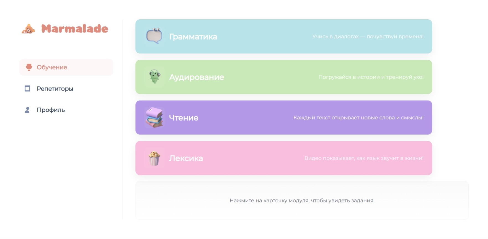
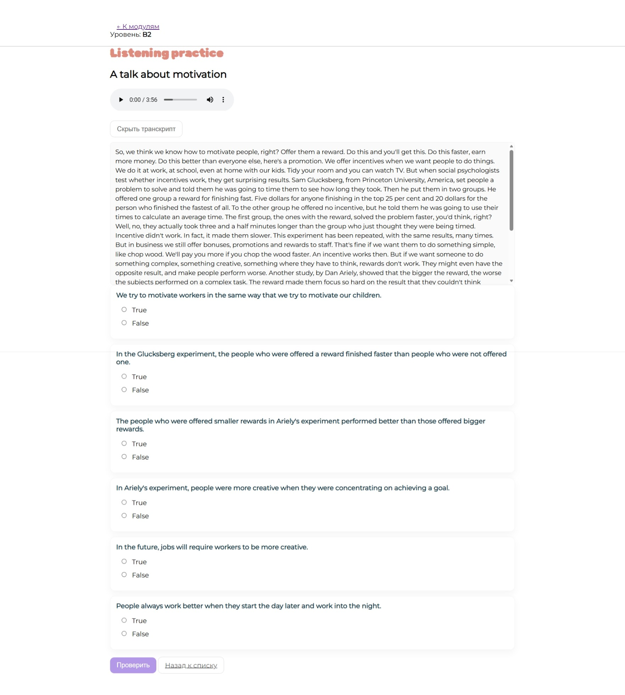
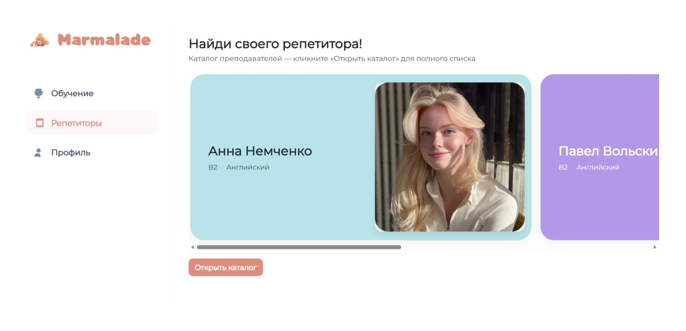
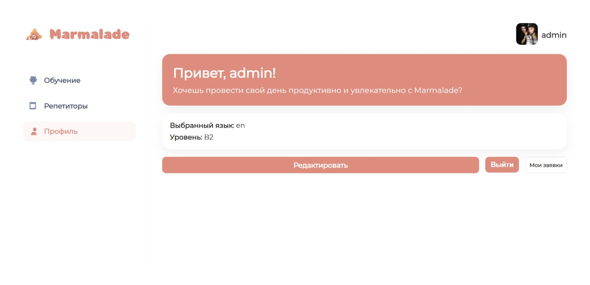
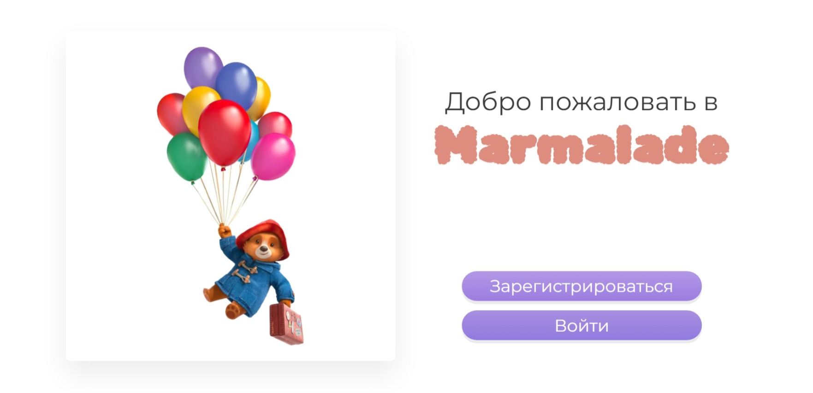
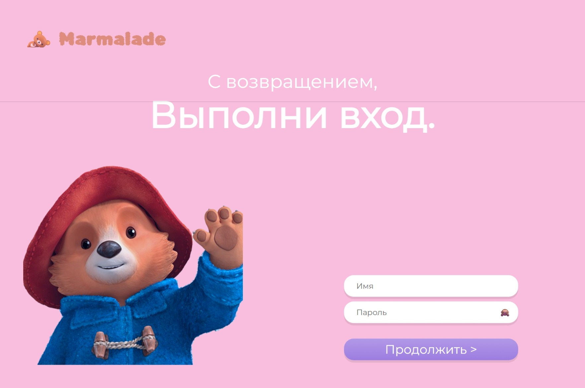
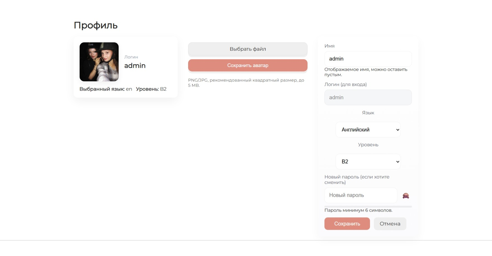
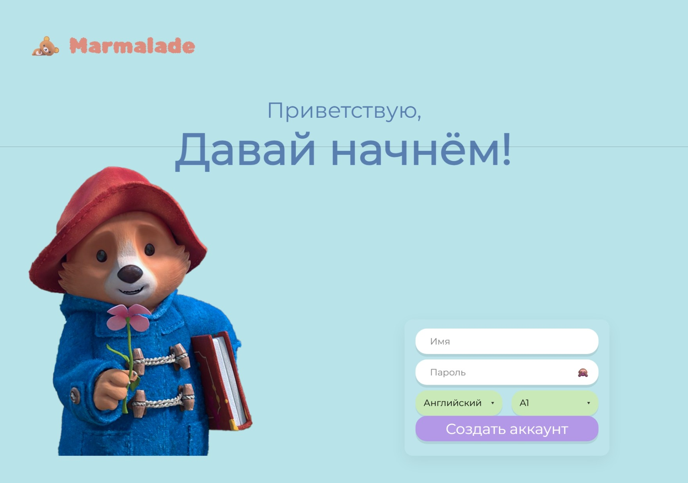
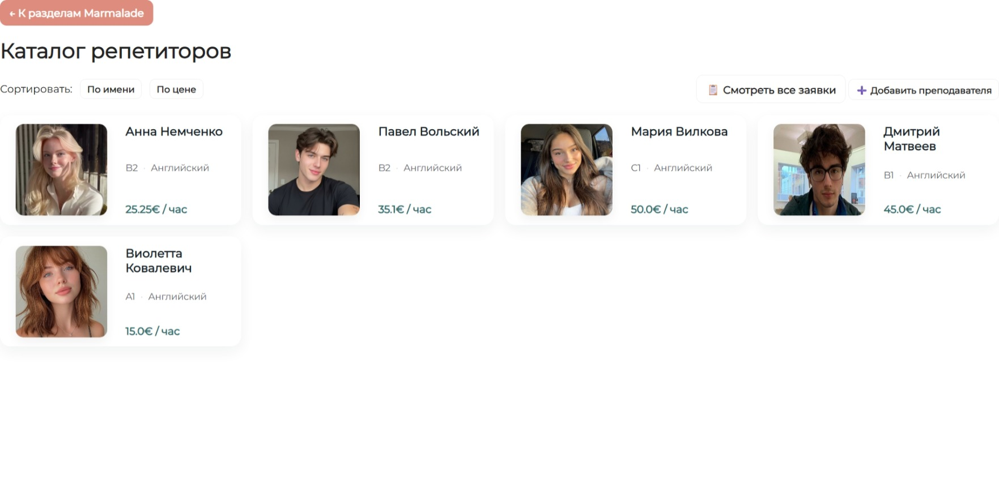
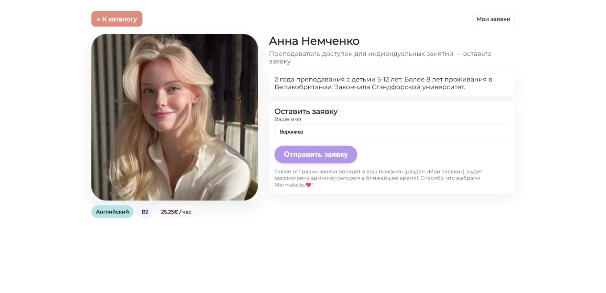

# Language Learning Web App

A multi-user web application for learning foreign languages. Users practice with interactive exercises and can browse a catalog of tutors and request lessons; administrators manage tutors and moderate requests.

Course project, BSUIR (Faculty of Computer Design), 2025.

## Features

**For users**
- Registration and login (preferred language and level are set in the profile; English is available at the current stage)
- Interactive learning modules: vocabulary, grammar, listening, reading
- Catalog of tutors with descriptions of experience and qualifications
- Lesson requests to a chosen tutor
- Profile editing: display name, language, level, avatar upload

**For administrators**
- Add, edit and delete tutors
- Manage and moderate lesson requests

## Tech stack

| Area | Technology |
|---|---|
| Language | Java 21 |
| Framework | Spring Boot 3.5.5 (Web, Security, Data JPA) |
| Database | MySQL 8 |
| Frontend | HTML, CSS |
| Build | Maven |
| IDE | IntelliJ IDEA |

## Architecture

MVC with a service layer:
- **Model**: JPA entities and services (business logic)
- **View**: HTML pages
- **Controller**: Spring MVC controllers (for example `ProfileController`)

Security: Spring Security, hashed passwords, `USER` and `ADMIN` roles.

## Getting started

### Requirements
- JDK 21
- MySQL 8.0+
- Maven 3.6+

### 1. Create the database
```sql
CREATE DATABASE language_app CHARACTER SET utf8mb4;
CREATE USER 'language_user'@'localhost' IDENTIFIED BY 'choose_a_password';
GRANT ALL PRIVILEGES ON language_app.* TO 'language_user'@'localhost';
```

### 2. Configure the connection
Set these environment variables (or edit `src/main/resources/application.properties` locally, without committing it):
```
DB_URL=jdbc:mysql://localhost:3306/language_app
DB_USER=language_user
DB_PASSWORD=choose_a_password
```

### 3. Build and run
```bash
mvn clean install
java -jar target/language-app-0.0.1-SNAPSHOT.jar
```
Open http://localhost:8080 in your browser.

## Screenshots

### Learning modules


### Exercises


### Tutors catalog


### Profile


### Home page


### Login


### Edit profile


### Register


### Choose and sort tutors


### Leave a class application



## Possible improvements
- Support for more languages and levels
- Progress tracking and statistics
- Online lessons with tutors

## Author
Veronika Kalugina, Telegram: @veronvrr
